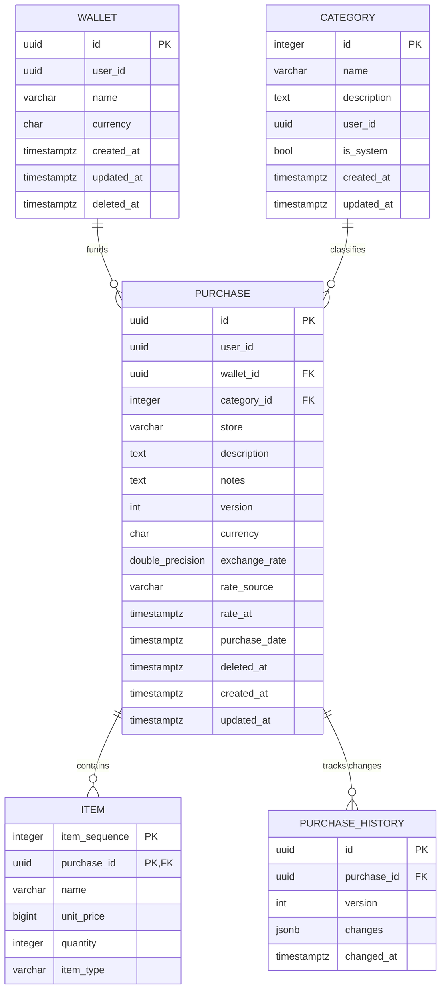
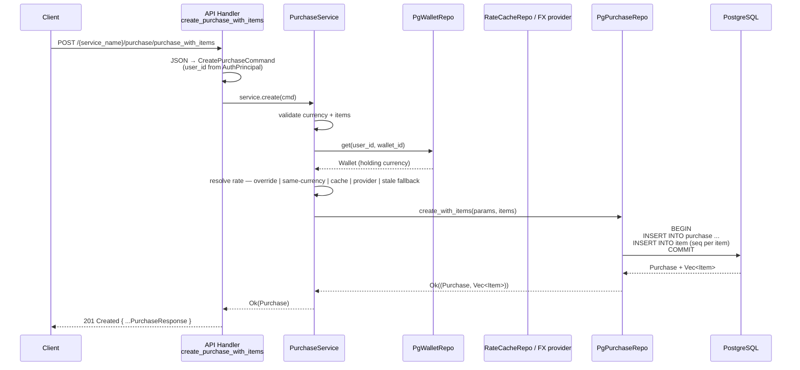

# Architecture: financial-management

Monolith. Axum. Postgres. Four layers. No microservices — domain too small, team too small.

---

## Implementation Status

| Path | Status | Notes |
|---|---|---|
| `src/config/` | Done | OTLP (traces + logs + metrics) + Postgres config, bb8 pool setup, connection string |
| `src/model/` | Done | All structs match migrated schema — currency columns (U2), BIGINT item prices (U5) |
| `src/application/error.rs` | Done | `ApplicationError` enum; `From<RepositoryError>` maps `NotFound`→`NotFound`, `VersionConflict`→`Conflict`, everything else→`Internal(String)` |
| `src/application/inbound/repositories.rs` | Done | Traits: Wallet, Purchase, Item, Category, PurchaseHistory, RateCache — plus params/filter structs |
| `src/application/purchase/service.rs` | Done | `PurchaseService<P,I,R,W,F>` — create (currency + rate resolution), get, list, update, add_items, update_item, remove_item, delete |
| `src/application/purchase/diff.rs` | Done | `PurchaseChanges` — JSONB history payloads, field + item diffs |
| `src/application/wallet/service.rs` | Done | `WalletService<W>` — create, list, get, update, delete |
| `src/application/category/service.rs` | Done | `CategoryService<C>` — create, list, get |
| `src/application/purchase_history/service.rs` | Done | `PurchaseHistoryService<P>` — list_for_purchase (not yet wired into routes) |
| `src/application/outbound/exchange_rate.rs` | Done | `ExchangeRateProvider` trait + `MockExchangeRateProvider` |
| `src/repository/mod.rs` | Done | `RepositoryError` (DbError, PoolError, NotFound, VersionConflict, Serde), `PgPool` type alias |
| `src/repository/purchase.rs` | Done | Transactions: purchase+items insert, version bump + history insert in one tx |
| `src/repository/item.rs` | Done | `PgItemRepo` — per-purchase sequence allocation, unit_price as BIGINT minor units |
| `src/repository/wallet.rs` | Done | `PgWalletRepo` — soft-delete via `deleted_at` |
| `src/repository/category.rs` | Done | `PgCategoryRepo` — system + user categories |
| `src/repository/rate_cache.rs` | Done | `PgRateCacheRepo` — top-of-hour cache over unlogged `exchange_rate_cache` |
| `src/repository/purchase_history.rs` | Done | `PgPurchaseHistoryRepo` — read side only (writes happen inside purchase tx) |
| `src/auth/` | Done | PASETO v4.local verifier, `TokenVerifier` trait, key provider abstraction, auth middleware |
| `src/api/mod.rs` | Done | `ApiError` with `From<ApplicationError>`, `setup_routes()`, `/health` endpoint |
| `src/api/purchase/` | Done | All 5 handlers wired |
| `src/api/item/` | Done | create, update, delete handlers |
| `src/api/wallet/` | Done | create, list, update, delete handlers |
| `src/api/category/` | Done | create, list handlers |
| `src/main.rs` | Done | `State<Arc<AppState>>`, all repos + services constructed, `.env` loaded, TraceLayer with latency histogram + 5xx counter |
| `Cargo.toml` | Done | Workspace members: root + `migrations` (refinery embed binary); deps incl. `pasetors`, `async-trait`, `dotenvy` |
| Migrations U1–U5 | Done | U1 init schema, U2 currency + unlogged rate cache, U3 category identity, U4 rate → double precision, U5 item price → bigint |
| Real FX provider | Pending | `MockExchangeRateProvider` in use |
| Real key provider | Pending | `StaticKeyProvider` (empty map) in use |
| Integration tests | Pending | Unit tests with mock repos exist for purchase service + diff |

`cargo check` passes with zero errors and zero warnings.

---

## Layer Architecture

```
┌─────────────────────────────────────────────────────┐
│                    HTTP Clients                      │
└────────────────────────┬────────────────────────────┘
                         │ HTTP
┌────────────────────────▼────────────────────────────┐
│                   API Layer                          │
│   src/api/                                           │
│   • Axum handlers — parse HTTP, call application     │
│   • Auth middleware — verifies tokens, injects       │
│     AuthPrincipal (src/auth/)                        │
│   • Request/Response DTOs (serde Deserialize)        │
│   • ApiError → HTTP status mapping                   │
│   • Route registration                               │
└────────────────────────┬────────────────────────────┘
                         │ Commands / Queries
┌────────────────────────▼────────────────────────────┐
│                Application Layer                     │
│   src/application/                                   │
│   • Use-case structs (PurchaseService, etc.)         │
│   • Owns business logic — validation, orchestration  │
│   • Calls repository traits (never concrete impls)   │
│   • Returns domain models or ApplicationError        │
└────────────────────────┬────────────────────────────┘
                         │ Repository Traits
┌────────────────────────▼────────────────────────────┐
│                Repository Layer                      │
│   src/repository/                                    │
│   • Implements traits from application/inbound/      │
│   • Raw SQL via tokio-postgres                       │
│   • Maps Row → domain model                          │
│   • Returns RepositoryError                          │
└────────────────────────┬────────────────────────────┘
                         │ SQL
┌────────────────────────▼────────────────────────────┐
│                  PostgreSQL                          │
│   Tables: wallet, category, purchase, item,          │
│           purchase_history, exchange_rate_cache      │
│           (unlogged)                                 │
│   Views:  purchase_items                             │
└─────────────────────────────────────────────────────┘
```

---

## Domain Model



---

## Module Structure

```
src/
├── main.rs                          # boot: build AppState + verifier, register routes, serve :8080
├── config/
│   ├── mod.rs                       # Config struct, env var helpers, tracing stack init
│   ├── otlpconfig.rs                # TracerConfig + MetricConfig + LogConfig traits + impl
│   └── postgresconfig.rs            # bb8 pool setup
│
├── model/                           # Pure domain structs — no DB, no HTTP
│   ├── mod.rs
│   ├── wallet.rs
│   ├── category.rs
│   ├── purchase.rs
│   ├── item.rs
│   └── purchase_history.rs
│
├── application/
│   ├── mod.rs
│   ├── error.rs                     # ApplicationError enum
│   ├── inbound/
│   │   ├── mod.rs
│   │   └── repositories.rs          # Repository traits + param/filter structs
│   ├── outbound/
│   │   ├── mod.rs
│   │   └── exchange_rate.rs         # ExchangeRateProvider trait + MockExchangeRateProvider
│   ├── purchase/
│   │   ├── mod.rs
│   │   ├── service.rs               # PurchaseService struct + use cases (+ unit tests)
│   │   ├── commands.rs              # Create/Update/AddItems/UpdateItem/RemoveItem commands
│   │   └── diff.rs                  # PurchaseChanges — JSONB history payloads
│   ├── wallet/
│   │   ├── mod.rs
│   │   └── service.rs
│   ├── category/
│   │   ├── mod.rs
│   │   └── service.rs
│   └── purchase_history/
│       ├── mod.rs
│       └── service.rs               # read-side history queries (not yet routed)
│
├── repository/
│   ├── mod.rs                       # RepositoryError, PgPool alias
│   ├── purchase.rs                  # impl PurchaseRepository for PgPurchaseRepo
│   ├── item.rs                      # impl ItemRepository for PgItemRepo
│   ├── wallet.rs                    # impl WalletRepository for PgWalletRepo
│   ├── category.rs                  # impl CategoryRepository for PgCategoryRepo
│   ├── purchase_history.rs          # impl PurchaseHistoryRepository for PgPurchaseHistoryRepo
│   ├── rate_cache.rs                # impl RateCacheRepository for PgRateCacheRepo
│   └── macros.rs                    # (empty placeholder)
│
├── auth/
│   ├── mod.rs                       # auth_middleware + AuthPrincipal
│   ├── verifier.rs                  # TokenVerifier trait + StaticUserVerifier (dev bypass)
│   ├── paseto.rs                    # PASETO v4.local verifier
│   └── key_provider.rs              # KeyProvider trait + StaticKeyProvider
│
└── api/
    ├── mod.rs                       # setup_routes(), ApiError, error mapping, /health
    ├── purchase/
    │   ├── mod.rs                   # setup_routes() for /purchase
    │   └── handlers/
    │       ├── mod.rs               # shared DTOs for purchase API
    │       ├── create_purchase_with_items.rs
    │       ├── get_purchase_details.rs
    │       ├── list_purchases.rs
    │       ├── update_purchase.rs
    │       └── delete_purchase.rs
    ├── item/
    │   ├── mod.rs
    │   └── handlers/
    │       ├── create_item.rs
    │       ├── update_item.rs
    │       └── delete_item.rs
    ├── wallet/
    │   ├── mod.rs
    │   └── handlers/
    │       ├── create_wallet.rs
    │       ├── list_wallets.rs
    │       ├── update_wallet.rs
    │       └── delete_wallet.rs
    └── category/
        ├── mod.rs
        └── handlers/
            ├── create_category.rs
            └── list_categories.rs
```

The cargo workspace has two members: the root binary and `migrations/` — a standalone refinery binary that embeds the SQL files and runs them (`Dockerfile.migrate` builds it).

---

## AppState and Dependency Injection

Code uses `axum::extract::State<Arc<AppState>>` — typesafe, catches missing state at compile time not runtime panic.

**AppState (src/main.rs):**

```rust
pub struct AppState {
    pub purchase_service: Arc<
        PurchaseService<
            PgPurchaseRepo,
            PgItemRepo,
            PgRateCacheRepo,
            PgWalletRepo,
            MockExchangeRateProvider,
        >,
    >,
    pub wallet_service:   Arc<WalletService<PgWalletRepo>>,
    pub category_service: Arc<CategoryService<PgCategoryRepo>>,
    pub item_repo:        Arc<PgItemRepo>, // update_item handler re-fetches the row after service.update_item
}
```

Routes are nested under `/{SERVICE_NAME}` (default `fin-management`). The token verifier is attached as an `Extension<Arc<dyn TokenVerifier>>` layer and consumed by `auth_middleware`.

Handlers extract state and principal, call only needed service:

```rust
pub async fn handler(
    State(state): State<Arc<AppState>>,
    Extension(principal): Extension<AuthPrincipal>,
    Json(body): Json<RequestBody>,
) -> Result<impl IntoResponse, ApiError> {
    let purchase = state.purchase_service.create(cmd).await?;
    Ok((StatusCode::CREATED, Json(response)).into_response())
}
```

Split into per-domain extension layers if compile times become problem. At this scale, one `AppState` fine.

---

## Error Handling Strategy

Three error types. Each layer owns its own. Conversions flow upward.

```
RepositoryError  →  ApplicationError  →  ApiError
(tokio-postgres)     (business logic)     (HTTP status)
```

**Repository error** — wraps DB failures:

```rust
// src/repository/mod.rs
#[derive(Debug, thiserror::Error)]
pub enum RepositoryError {
    #[error("Database error: {0}")]
    DbError(#[from] tokio_postgres::Error),
    #[error("Pool error: {0}")]
    PoolError(#[from] bb8_postgres::bb8::RunError<tokio_postgres::Error>),
    #[error("Row not found")]
    NotFound,
    #[error("Version conflict")]
    VersionConflict,
    #[error("Serialization error: {0}")]
    Serde(#[from] serde_json::Error),
}
```

**Application error** — lives in `application/error.rs`:

```rust
// src/application/error.rs
#[derive(Debug, thiserror::Error)]
pub enum ApplicationError {
    #[error("Not found: {0}")]
    NotFound(String),
    #[error("Conflict: {0}")]
    Conflict(String),
    #[error("Unauthorized")]
    Unauthorized,
    #[error("Validation error: {0}")]
    Validation(String),
    #[error("Serialization error: {0}")]
    Serialization(#[from] serde_json::Error),
    #[error("Internal error: {0}")]
    Internal(String),
}

impl From<RepositoryError> for ApplicationError {
    fn from(e: RepositoryError) -> Self {
        match e {
            RepositoryError::NotFound => ApplicationError::NotFound("resource not found".into()),
            RepositoryError::VersionConflict => ApplicationError::Conflict(
                "version mismatch: the resource was modified; reload and retry".into(),
            ),
            other => ApplicationError::Internal(other.to_string()),
        }
    }
}
```

`From<RepositoryError>` on `ApplicationError` means repository calls use `?` directly — `NotFound` surfaces as HTTP 404 and `VersionConflict` (stale optimistic-lock version) as HTTP 409; all other repository errors are 500.

**API error** — maps to HTTP:

```rust
// src/api/mod.rs
#[derive(Debug, thiserror::Error)]
pub enum ApiError {
    #[error("{0}")]
    NotFound(String),
    #[error("{0}")]
    Conflict(String),
    #[error("Unauthorized")]
    Unauthorized,
    #[error("{0}")]
    BadRequest(String),
    #[error("Internal server error")]
    Internal,
}

impl From<ApplicationError> for ApiError {
    fn from(e: ApplicationError) -> Self {
        match e {
            ApplicationError::NotFound(msg)   => ApiError::NotFound(msg),
            ApplicationError::Conflict(msg)   => ApiError::Conflict(msg),
            ApplicationError::Unauthorized    => ApiError::Unauthorized,
            ApplicationError::Validation(msg) => ApiError::BadRequest(msg),
            ApplicationError::Serialization(_) => ApiError::Internal,
            ApplicationError::Internal(_)     => ApiError::Internal,
        }
    }
}

impl IntoResponse for ApiError {
    fn into_response(self) -> Response {
        let (status, body) = match &self {
            ApiError::NotFound(msg)  => (StatusCode::NOT_FOUND, msg.clone()),
            ApiError::Conflict(msg)  => (StatusCode::CONFLICT, msg.clone()),
            ApiError::Unauthorized   => (StatusCode::UNAUTHORIZED, "Unauthorized".into()),
            ApiError::BadRequest(msg)=> (StatusCode::BAD_REQUEST, msg.clone()),
            ApiError::Internal       => (StatusCode::INTERNAL_SERVER_ERROR, "Internal server error".into()),
        };
        (status, Json(json!({ "error": body }))).into_response()
    }
}
```

Handlers return `Result<_, ApiError>`, use `?` on `ApplicationError` — `From` impl does conversion.

---

## Authentication

Token-based, no sessions. `auth_middleware` (`src/auth/mod.rs`, applied via `from_fn` inside `api::setup_routes()`) reads the `Authorization` header and delegates to a `TokenVerifier` injected from `main.rs` as `Extension<Arc<dyn TokenVerifier>>`. On success it inserts `AuthPrincipal { user_id }` into the request extensions; handlers extract `Extension<AuthPrincipal>`.

- Default verifier: `PasetoVerifier` — PASETO v4.local. The token footer carries a `kid`, resolved to a symmetric key via `KeyProvider` (an external key service owns key material and rotation; today a `StaticKeyProvider` with an empty map, pending the real service).
- Dev bypass: `AUTH_SKIP_VERIFY=1` → `StaticUserVerifier`, which accepts any token (or a missing header) and authenticates as `AUTH_DEFAULT_USER_ID`, defaulting to `00000000-0000-0000-0000-000000000001`.

Failure mapping: missing/invalid token → 401, unknown key id → 401, key provider failure → 503, internal verification failure → 500.

---

## Repository Pattern

Repository traits in `application/inbound/repositories.rs`. Concrete impls in `src/repository/`.

Trait uses async-in-trait syntax (Rust 1.75+) — keep. No `async_trait` macro needed (the `auth/` traits do use `#[async_trait]`; repository traits rely on `#![allow(async_fn_in_trait)]` instead).

**Pattern for one implementation:**

```rust
// src/repository/wallet.rs
use crate::application::inbound::repositories::{WalletRepository, Result};
use crate::model::wallet::Wallet;
use super::{RepositoryError, PgPool};

pub struct PgWalletRepo {
    pool: PgPool,
}

impl PgWalletRepo {
    pub fn new(pool: ...) -> Self { Self { pool } }
}

impl WalletRepository for PgWalletRepo {
    async fn create(&self, user_id: Uuid, name: String) -> Result<Wallet> {
        let conn = self.pool.get().await
            .map_err(|e| RepositoryError::PoolError(e))?;

        let row = conn
            .query_one(
                "INSERT INTO wallet (id, user_id, name) VALUES ($1, $2, $3) RETURNING *",
                &[&Uuid::new_v4(), &user_id, &name],
            )
            .await
            .map_err(RepositoryError::DbError)?;

        Ok(row_to_wallet(&row))
    }
    // ...
}

fn row_to_wallet(row: &tokio_postgres::Row) -> Wallet {
    Wallet {
        id:         row.get("id"),
        user_id:    row.get("user_id"),
        name:       row.get("name"),
        currency:   row.get("currency"), // default 'USD' from migration U2
        created_at: row.get("created_at"),
        updated_at: row.get("updated_at"),
        deleted_at: row.get("deleted_at"),
    }
}
```

`Result<T>` type alias in `application/inbound/repositories.rs` is `Result<T, ApplicationError>`. Repo impls return `RepositoryError` internally and convert via `From` at the `?` site — no manual mapping. (`NotFound` → 404, `VersionConflict` → 409.)

---

## Application Service Pattern

Services own use-case logic. Receive command/query structs, call repos, enforce rules.

```rust
// src/application/purchase/service.rs
use crate::application::inbound::repositories::{
    ItemRepository, PurchaseRepository, RateCacheRepository, WalletRepository,
};
use crate::application::outbound::exchange_rate::ExchangeRateProvider;
use crate::application::error::ApplicationError;
use crate::model::purchase::Purchase;

pub struct PurchaseService<P, I, R, W, F>
where
    P: PurchaseRepository,
    I: ItemRepository,
    R: RateCacheRepository,
    W: WalletRepository,
    F: ExchangeRateProvider,
{
    purchases: P,
    items:     I,
    rate_cache: R,
    wallets:    W,
    fx:         F,
}

impl<P, I, R, W, F> PurchaseService<P, I, R, W, F>
where
    P: PurchaseRepository,
    I: ItemRepository,
    R: RateCacheRepository,
    W: WalletRepository,
    F: ExchangeRateProvider,
{
    pub fn new(purchases: P, items: I, rate_cache: R, wallets: W, fx: F) -> Self {
        Self { purchases, items, rate_cache, wallets, fx }
    }

    pub async fn create(
        &self,
        cmd: CreatePurchaseCommand,
    ) -> Result<Purchase, ApplicationError> {
        // 1. validate currency (3-letter ISO 4217) + items (quantity > 0, unit_price >= 0)
        let currency = cmd.currency.to_uppercase();
        validate_currency(&currency)?;
        validate_items(&cmd.items)?;

        // 2. load wallet — defines the holding currency
        let wallet = self.wallets.get(cmd.user_id, cmd.wallet_id).await?;

        // 3. resolve exchange rate (see Currency & Exchange Rates)
        let (exchange_rate, rate_source, rate_at) = self
            .resolve_rate(&cmd, &currency, &wallet.currency, cmd.purchase_date)
            .await?;

        // 4. atomic persist — purchase + items in one transaction
        let params = CreatePurchaseParams { /* fields from cmd + rate */ };
        let (purchase, _items) = self.purchases.create_with_items(params, cmd.items).await?;

        tracing::info!(monotonic_counter.purchase_created_total = 1);
        Ok(purchase)
    }

    // also: get, list, update (diff-based), add_items, update_item,
    // remove_item, delete — all call repos, all #![instrument]-ed
}
```

```rust
// src/application/purchase/commands.rs
use crate::application::inbound::repositories::ItemInput;

pub struct CreatePurchaseCommand {
    pub user_id:                uuid::Uuid,
    pub wallet_id:              uuid::Uuid,
    pub category_id:            i32,
    pub store:                  Option<String>,
    pub description:            Option<String>,
    pub notes:                  Option<String>,
    pub currency:               String,
    pub exchange_rate_override: Option<f64>,
    pub purchase_date:          Option<chrono::DateTime<chrono::Utc>>,
    pub items:                  Vec<ItemInput>,
}

pub struct UpdatePurchaseCommand {
    pub id:              uuid::Uuid,
    pub user_id:         uuid::Uuid,
    pub current_version: i32,
    pub store:           Option<String>,
    pub description:     Option<String>,
    pub notes:           Option<String>,
    pub category_id:     Option<i32>,
}

pub struct AddItemsCommand  { id, user_id, current_version, items: Vec<ItemInput> }
pub struct UpdateItemCommand { id, user_id, current_version, sequence, name, unit_price: Option<i64>, quantity: Option<i32>, item_type }
pub struct RemoveItemCommand { id, user_id, current_version, sequence }
```

`ItemInput` carries `unit_price: i64` — prices are minor units (e.g. cents), matching the BIGINT `item.unit_price` column.

---

## Currency & Exchange Rates

Purchases carry their own currency (`char(3)`), independent of the wallet's holding currency. On create, the service resolves the rate (wallet currency = target):

1. `exchange_rate_override` > 0 wins — `rate_source = "manual"`, no cache or provider call
2. source currency == wallet currency → no rate stored
3. top-of-hour cache lookup (of `purchase_date`, or now) in `exchange_rate_cache`
4. cache miss → `ExchangeRateProvider.fetch_rate()` → result cached
5. provider failure → fall back to most recent cached rate of any age; none → `Internal` error

Every purchase stores `currency`, `exchange_rate`, `rate_source`, `rate_at` so totals can be recomputed. The `purchase_items` view exposes both `total` (source currency) and `total_wallet`. The unlogged cache is safe to lose — rates are denormalized onto purchase rows.

Prices are entered in minor units; item prices are BIGINT, rates are DOUBLE PRECISION (migrations U4/U5 exist because tokio-postgres maps `f64`/`i64` only to those types, not NUMERIC).

---

## Handler Pattern (API Layer)

Handlers thin. Parse input, call service, map result. No business logic.

```rust
// src/api/purchase/handlers/create_purchase_with_items.rs
use axum::{
    extract::{State},
    http::StatusCode,
    response::IntoResponse,
    Extension, Json,
};
use serde::Deserialize;
use std::sync::Arc;
use uuid::Uuid;

use crate::{
    api::ApiError,
    application::purchase::commands::CreatePurchaseCommand,
    auth::AuthPrincipal,
    AppState,
};

use super::{ItemDto, PurchaseResponse};

#[derive(Debug, Deserialize)]
pub struct RequestBody {
    pub wallet_id:     Uuid,
    pub category_id:   i32,
    pub store:         Option<String>,
    pub description:   Option<String>,
    pub notes:         Option<String>,
    pub currency:      String,
    #[serde(default)]
    pub exchange_rate_override: Option<f64>,
    pub purchase_date: Option<chrono::DateTime<chrono::Utc>>,
    pub items:         Vec<ItemDto>,
}

// ItemDto (in handlers/mod.rs): name: String, unit_price: i64,
// quantity: i32, item_type: Option<String> — converts Into ItemInput

pub async fn handler(
    State(state): State<Arc<AppState>>,
    Extension(principal): Extension<AuthPrincipal>,
    Json(body): Json<RequestBody>,
) -> Result<impl IntoResponse, ApiError> {
    let cmd = CreatePurchaseCommand {
        user_id:       principal.user_id, // from auth middleware
        wallet_id:     body.wallet_id,
        category_id:   body.category_id,
        store:         body.store,
        description:   body.description,
        notes:         body.notes,
        currency:      body.currency,
        exchange_rate_override: body.exchange_rate_override,
        purchase_date: body.purchase_date,
        items:         body.items.into_iter().map(Into::into).collect(),
    };

    let purchase = state.purchase_service.create(cmd).await?;

    Ok((StatusCode::CREATED, Json(PurchaseResponse::from(purchase))).into_response())
}
```

`?` on `state.purchase_service.create(cmd).await?` works because `ApiError: From<ApplicationError>`.

---

## Data Flow: Create Purchase



Routes are nested under `/{SERVICE_NAME}` (default `fin-management`), so the full path is e.g. `/fin-management/purchase/purchase_with_items`.

---

## Pagination and Filtering

`PurchaseFilters` in `application/inbound/repositories.rs` good. Default `limit`/`offset` in service layer, not repo. Repo executes whatever it receives.

Service defaults:
- `limit`: 50
- `offset`: 0
- `start_date`: 30 days ago if not provided

(The repo re-applies the same defaults if called directly.) Note: `PurchaseFilters.store` is accepted at the API and trait level but the repo's list SQL does not apply it yet — see audit report.

---

## PurchaseHistory (Audit Trail)

Every purchase mutation writes one row to `purchase_history` inside the same DB transaction as the mutation itself — the version bump and the history insert are atomic. Nothing lags.

The payload is `PurchaseChanges` (`application/purchase/diff.rs`), serialized to JSONB and tagged by `action`:

- `PurchaseUpdated { fields: { store|description|notes|category_id: {from, to} } }` — service computes the diff first; a no-op update bumps nothing and writes nothing
- `PurchaseDeleted`
- `ItemAdded { items: [ItemSnapshot] }`
- `ItemUpdated { items: [{ item_sequence, from, to }] }`
- `ItemRemoved { items: [ItemSnapshot] }`

The service builds the change payload; the repo persists it (`insert_history` inside the transaction). Reads go through `PurchaseHistoryRepository::get_for_purchase` / `PurchaseHistoryService::list_for_purchase` — not yet exposed via an API route.

`version` on `purchase` doubles as the optimistic concurrency guard:

```sql
UPDATE purchase SET ..., version = version + 1
WHERE id = $1 AND user_id = $2 AND version = $3 AND deleted_at IS NULL
RETURNING *
```

0 rows returned → a follow-up existence check (`miss_reason`) decides: purchase gone or not owned → `RepositoryError::NotFound` (404); purchase exists → `RepositoryError::VersionConflict` (409).

---

## What to Build Next

1. Real exchange rate provider — swap `MockExchangeRateProvider` (it only serves pre-loaded pairs or same-currency 1.0)
2. Real key provider — replace `StaticKeyProvider` (empty map) with a client to the external key service owning key material + rotation
3. Expose purchase history — wire `PurchaseHistoryService`/`PgPurchaseHistoryRepo` into AppState and an API route
4. Store filter — apply `PurchaseFilters.store` in the repo list SQL
5. Integration tests — spin up test Postgres, run migrations, test service layer against real DB
6. Pagination response envelope — return `{ data: [...], total: N, limit: N, offset: N }` from list endpoints

---

## Observability

OTLP traces, logs, and metrics are all wired (`config::Config::init` builds three layers on the tracing registry: `tracing_opentelemetry::layer` for traces, `OpenTelemetryTracingBridge` for logs with trace/span correlation, and `MetricsLayer` for metrics emitted from events).

`TraceLayer` on the router creates a custom span per request (`http.request.method/host/url`, `otel.name`, `http.response.status`) and its `on_response` hook emits:

- `histogram.http_request_duration_ms` — request latency
- `counter.http_5xx_total` — 5xx error counter (alert source)

Services use `#[instrument]` (already in place) and can emit business metrics as event fields:

```rust
use tracing::instrument;

impl<P, I, R, W, F> PurchaseService<P, I, R, W, F> {
    #[instrument(skip(self), fields(user_id = %cmd.user_id, wallet_id = %cmd.wallet_id))]
    pub async fn create(&self, cmd: CreatePurchaseCommand) -> Result<Purchase, ApplicationError> {
        // ...
        tracing::info!(monotonic_counter.purchase_created_total = 1);
    }
}
```

`#[instrument]` emits spans picked up by the `tracing-opentelemetry` layer, exported via OTLP. Metrics via `counter.`/`histogram.` field prefixes are picked up by `MetricsLayer` and exported via OTLP. Zero extra code beyond the event field.

---

## Technology Decisions

| Concern | Choice | Reason |
|---|---|---|
| Web framework | Axum 0.7 | Already in use. Tower ecosystem, good extractor model |
| DB driver | tokio-postgres + bb8 | Already in use. No ORM overhead, full SQL control |
| Migrations | refinery | Already in use. Standalone binary, version-controlled SQL (U1–U5) |
| Serialization | serde + serde_json | Standard |
| Error handling | thiserror | Already in use. Derive macros, no runtime cost |
| Auth | PASETO v4.local (`pasetors`) + `KeyProvider` trait | Footer `kid` → external key service; verifier swappable via `TokenVerifier` |
| Observability | OpenTelemetry + OTLP | Already in use. Vendor-neutral traces + logs + metrics |
| IDs | uuid v4 | Already in use. No coordination needed |
| Timestamps | chrono + TIMESTAMPTZ | Already in use. Always UTC in DB |
| Async runtime | tokio | Already in use |

Don't add `sqlx` — `tokio-postgres` works, repo traits abstract DB. Don't add `diesel` — same reason. No ORM.

Don't add `anyhow` — `thiserror` with explicit types better for layered arch needing cross-boundary error matching. `anyhow` for "just propagate" code, not three distinct error domains.
