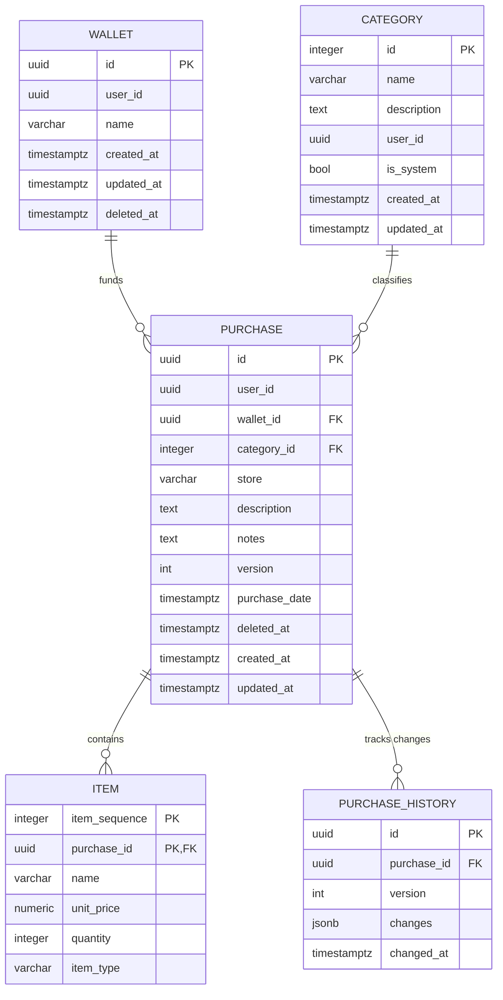
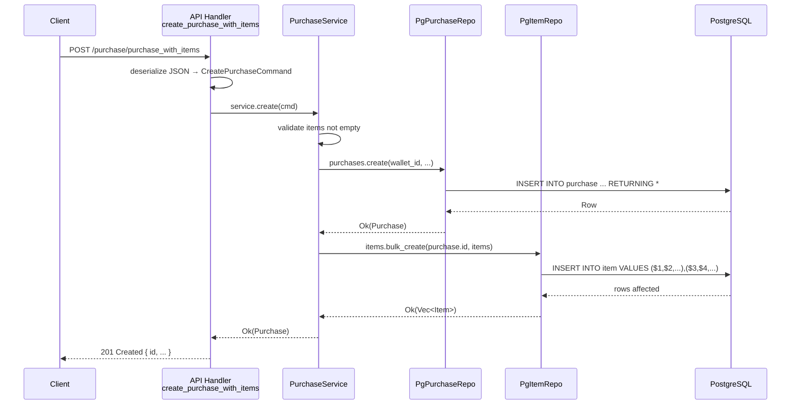

# Architecture: financial-management

Monolith. Axum. Postgres. Four layers. No microservices — domain too small, team too small.

---

## Implementation Status

| Path | Status | Notes |
|---|---|---|
| `src/config/` | Done | OTLP + Postgres config, pool setup, connection string fixed |
| `src/model/` | Done | All structs match schema — correct types, composite PKs, nullable fields |
| `src/application/error.rs` | Done | `ApplicationError` enum with `From<RepositoryError>` |
| `src/application/inbound/repositories.rs` | Done | All repository traits defined — Wallet, Purchase, Item, Category, PurchaseHistory |
| `src/application/purchase/service.rs` | Done | `PurchaseService<P,I>` — create, get, list, update (optimistic concurrency), delete |
| `src/application/wallet/service.rs` | Done | `WalletService<W>` — create, list, update, delete |
| `src/application/category/service.rs` | Done | `CategoryService<C>` — create, list |
| `src/repository/mod.rs` | Done | `RepositoryError` (DbError, PoolError, NotFound), `PgPool` type alias |
| `src/repository/purchase.rs` | Done | `PgPurchaseRepo` — optimistic concurrency via `WHERE version = $N RETURNING *` |
| `src/repository/item.rs` | Done | `PgItemRepo` — bulk_create with auto-increment sequence, NUMERIC cast to f64 |
| `src/repository/wallet.rs` | Done | `PgWalletRepo` — soft-delete via `deleted_at` |
| `src/repository/category.rs` | Done | `PgCategoryRepo` |
| `src/repository/purchase_history.rs` | Done | `PgPurchaseHistoryRepo` |
| `src/api/mod.rs` | Done | `ApiError` with `From<ApplicationError>`, `setup_routes()`, HTTP status mapping |
| `src/api/purchase/` | Done | All 5 handlers wired |
| `src/api/item/` | Done | create, update, delete handlers |
| `src/api/wallet/` | Done | create, list, update, delete handlers |
| `src/api/category/` | Done | create, list handlers |
| `src/main.rs` | Done | `State<Arc<AppState>>` (not Extension), all repos + services constructed, `.env` loaded |
| `Cargo.toml` | Fixed | Removed dead `macros`/`traits` workspace members, added `dotenvy`, fixed `serde_json` feature |
| Migration SQL | Fixed | Typo `wallter`→`wallet`, removed trailing commas, fixed inline INDEX syntax |
| Auth middleware | Pending | `user_id` hardcoded as `Uuid::nil()` — needs real JWT/session extraction |

`cargo check` passes with zero errors and zero warnings.

---

## Layer Architecture

```
┌─────────────────────────────────────────────────────┐
│                    HTTP Clients                      │
└────────────────────────┬────────────────────────────┘
                         │ HTTP
┌────────────────────────▼────────────────────────────┐
│                   API Layer                          │
│   src/api/                                           │
│   • Axum handlers — parse HTTP, call application     │
│   • Request/Response DTOs (serde Deserialize)        │
│   • ApiError → HTTP status mapping                   │
│   • Route registration                               │
└────────────────────────┬────────────────────────────┘
                         │ Commands / Queries
┌────────────────────────▼────────────────────────────┐
│                Application Layer                     │
│   src/application/                                   │
│   • Use-case structs (PurchaseService, etc.)         │
│   • Owns business logic — validation, orchestration  │
│   • Calls repository traits (never concrete impls)   │
│   • Returns domain models or ApplicationError        │
└────────────────────────┬────────────────────────────┘
                         │ Repository Traits
┌────────────────────────▼────────────────────────────┐
│                Repository Layer                      │
│   src/repository/                                    │
│   • Implements traits from application/inbound/      │
│   • Raw SQL via tokio-postgres                       │
│   • Maps Row → domain model                          │
│   • Returns RepositoryError                          │
└────────────────────────┬────────────────────────────┘
                         │ SQL
┌────────────────────────▼────────────────────────────┐
│                  PostgreSQL                          │
│   Tables: wallet, category, purchase, item,          │
│           purchase_history                           │
│   Views:  purchase_items                             │
└─────────────────────────────────────────────────────┘
```

---

## Domain Model



---

## Module Structure (Target)

```
src/
├── main.rs                          # boot: build AppState, register routes, serve
├── config/
│   ├── mod.rs                       # Config struct, env var helpers
│   ├── otlpconfig.rs                # TracerConfig + LogConfig traits + impl
│   └── postgresconfig.rs            # bb8 pool setup
│
├── model/                           # Pure domain structs — no DB, no HTTP
│   ├── mod.rs
│   ├── wallet.rs
│   ├── category.rs
│   ├── purchase.rs
│   ├── item.rs
│   └── purchase_history.rs
│
├── application/
│   ├── mod.rs
│   ├── error.rs                     # ApplicationError enum
│   ├── inbound/
│   │   ├── mod.rs
│   │   └── repositories.rs          # Repository traits (already started)
│   ├── purchase/
│   │   ├── mod.rs
│   │   ├── service.rs               # PurchaseService struct + use cases
│   │   └── commands.rs              # CreatePurchaseCommand, UpdatePurchaseCommand
│   ├── wallet/
│   │   ├── mod.rs
│   │   └── service.rs
│   └── category/
│       ├── mod.rs
│       └── service.rs
│
├── repository/
│   ├── mod.rs                       # RepositoryError, push_values helper
│   ├── purchase.rs                  # impl PurchaseRepository for PgPurchaseRepo
│   ├── item.rs                      # impl ItemRepository for PgItemRepo
│   ├── wallet.rs                    # impl WalletRepository for PgWalletRepo
│   └── category.rs                  # impl CategoryRepository for PgCategoryRepo
│
└── api/
    ├── mod.rs                       # setup_routes(), ApiError, error mapping
    ├── purchase/
    │   ├── mod.rs                   # setup_routes() for /purchase
    │   └── handlers/
    │       ├── mod.rs               # shared DTOs for purchase API
    │       ├── create_purchase_with_items.rs
    │       ├── get_purchase_details.rs
    │       ├── list_purchases.rs
    │       ├── update_purchase.rs
    │       └── delete_purchase.rs
    ├── item/
    │   ├── mod.rs
    │   └── handlers/
    │       ├── create_item.rs
    │       ├── update_item.rs
    │       └── delete_item.rs
    ├── wallet/
    │   ├── mod.rs
    │   └── handlers/
    │       ├── create_wallet.rs
    │       ├── list_wallets.rs
    │       ├── update_wallet.rs
    │       └── delete_wallet.rs
    └── category/
        ├── mod.rs
        └── handlers/
            ├── create_category.rs
            └── list_categories.rs
```

Drop `macros` and `traits` workspace crates from `Cargo.toml` — don't exist, not needed. Repository trait abstractions live in `application/inbound/repositories.rs` already.

---

## AppState and Dependency Injection

Current code uses `Extension(Arc<AppState>)`. Migrate to `axum::extract::State<Arc<AppState>>` — typesafe, catches missing state at compile time not runtime panic.

**AppState pattern:**

```rust
// src/main.rs
pub struct AppState {
    pub purchase_service: Arc<PurchaseService<PgPurchaseRepo, PgItemRepo>>,
    pub wallet_service:   Arc<WalletService<PgWalletRepo>>,
    // logger stays here — used for structured emit outside tracing spans
    pub logger: LoggerWrapper,
}
```

Handlers extract full state, call only needed service:

```rust
pub async fn handler(
    State(state): State<Arc<AppState>>,
    Json(body): Json<RequestBody>,
) -> Result<impl IntoResponse, ApiError> {
    let result = state.purchase_service.create(body.into()).await?;
    Ok((StatusCode::CREATED, Json(result)).into_response())
}
```

Split into per-domain extension layers if compile times become problem. At this scale, one `AppState` fine.

---

## Error Handling Strategy

Three error types. Each layer owns its own. Conversions flow upward.

```
RepositoryError  →  ApplicationError  →  ApiError
(tokio-postgres)     (business logic)     (HTTP status)
```

**Repository error** — wraps DB failures:

```rust
// src/repository/mod.rs
#[derive(Debug, thiserror::Error)]
pub enum RepositoryError {
    #[error("Database error: {0}")]
    DbError(#[from] tokio_postgres::Error),
    #[error("Pool error: {0}")]
    PoolError(#[from] bb8_postgres::bb8::RunError<tokio_postgres::Error>),
    #[error("Row not found")]
    NotFound,
}
```

**Application error** — already started in `application/inbound/repositories.rs`, move to `application/error.rs`:

```rust
// src/application/error.rs
#[derive(Debug, thiserror::Error)]
pub enum ApplicationError {
    #[error("Not found: {0}")]
    NotFound(String),
    #[error("Conflict: {0}")]
    Conflict(String),
    #[error("Unauthorized")]
    Unauthorized,
    #[error("Validation error: {0}")]
    Validation(String),
    #[error("Internal error")]
    Internal(#[from] RepositoryError),
}
```

`From<RepositoryError>` on `ApplicationError` means repository calls in services use `?` directly.

**API error** — maps to HTTP:

```rust
// src/api/mod.rs
#[derive(Debug, thiserror::Error)]
pub enum ApiError {
    #[error("{0}")]
    NotFound(String),
    #[error("{0}")]
    Conflict(String),
    #[error("Unauthorized")]
    Unauthorized,
    #[error("{0}")]
    BadRequest(String),
    #[error("Internal server error")]
    Internal,
}

impl From<ApplicationError> for ApiError {
    fn from(e: ApplicationError) -> Self {
        match e {
            ApplicationError::NotFound(msg)   => ApiError::NotFound(msg),
            ApplicationError::Conflict(msg)   => ApiError::Conflict(msg),
            ApplicationError::Unauthorized    => ApiError::Unauthorized,
            ApplicationError::Validation(msg) => ApiError::BadRequest(msg),
            ApplicationError::Internal(_)     => ApiError::Internal,
        }
    }
}

impl IntoResponse for ApiError {
    fn into_response(self) -> Response {
        let (status, body) = match &self {
            ApiError::NotFound(msg)  => (StatusCode::NOT_FOUND, msg.clone()),
            ApiError::Conflict(msg)  => (StatusCode::CONFLICT, msg.clone()),
            ApiError::Unauthorized   => (StatusCode::UNAUTHORIZED, "Unauthorized".into()),
            ApiError::BadRequest(msg)=> (StatusCode::BAD_REQUEST, msg.clone()),
            ApiError::Internal       => (StatusCode::INTERNAL_SERVER_ERROR, "Internal server error".into()),
        };
        (status, Json(json!({ "error": body }))).into_response()
    }
}
```

Handlers return `Result<_, ApiError>`, use `?` on `ApplicationError` — `From` impl does conversion.

---

## Repository Pattern

Repository traits in `application/inbound/repositories.rs` (already there). Concrete impls in `src/repository/`.

Trait uses async-in-trait syntax (Rust 1.75+) — keep. No `async_trait` macro needed.

**Pattern for one implementation:**

```rust
// src/repository/wallet.rs
use crate::application::inbound::repositories::{WalletRepository, Result};
use crate::model::wallet::Wallet;
use super::{RepositoryError, PgPool};

pub struct PgWalletRepo {
    pool: bb8_postgres::bb8::Pool<bb8_postgres::PostgresConnectionManager<tokio_postgres::NoTls>>,
}

impl PgWalletRepo {
    pub fn new(pool: ...) -> Self { Self { pool } }
}

impl WalletRepository for PgWalletRepo {
    async fn create(&self, user_id: Uuid, name: String) -> Result<Wallet> {
        let conn = self.pool.get().await
            .map_err(|e| RepositoryError::PoolError(e))?;

        let row = conn
            .query_one(
                "INSERT INTO wallet (id, user_id, name) VALUES ($1, $2, $3) RETURNING *",
                &[&Uuid::new_v4(), &user_id, &name],
            )
            .await
            .map_err(RepositoryError::DbError)?;

        Ok(row_to_wallet(&row))
    }
    // ...
}

fn row_to_wallet(row: &tokio_postgres::Row) -> Wallet {
    Wallet {
        id:         row.get("id"),
        user_id:    row.get("user_id"),
        name:       row.get("name"),
        created_at: row.get("created_at"),
        updated_at: row.get("updated_at"),
        deleted_at: row.get("deleted_at"),
    }
}
```

`Result<T>` type alias in `application/inbound/repositories.rs` maps `RepositoryError` via `From` on `ApplicationError`. Impl converts at `?` site — no manual mapping.

---

## Application Service Pattern

Services own use-case logic. Receive command/query structs, call repos, enforce rules.

```rust
// src/application/purchase/service.rs
use crate::application::inbound::repositories::{
    PurchaseRepository, ItemRepository, PurchaseFilters
};
use crate::application::error::ApplicationError;
use crate::model::purchase::Purchase;

pub struct PurchaseService<P, I>
where
    P: PurchaseRepository,
    I: ItemRepository,
{
    purchases: P,
    items:     I,
}

impl<P, I> PurchaseService<P, I>
where
    P: PurchaseRepository,
    I: ItemRepository,
{
    pub fn new(purchases: P, items: I) -> Self {
        Self { purchases, items }
    }

    pub async fn create(
        &self,
        cmd: CreatePurchaseCommand,
    ) -> Result<Purchase, ApplicationError> {
        // validate
        if cmd.items.is_empty() {
            return Err(ApplicationError::Validation(
                "purchase must have at least one item".into()
            ));
        }

        // create purchase record
        let purchase = self.purchases.create(
            cmd.wallet_id,
            cmd.store,
            cmd.notes,
            cmd.user_id,
            cmd.category_id,
            cmd.purchase_date,
        ).await?;

        // bulk-create items
        self.items.bulk_create(purchase.id, cmd.items).await?;

        Ok(purchase)
    }
}
```

```rust
// src/application/purchase/commands.rs
use crate::application::inbound::repositories::ItemInput;

pub struct CreatePurchaseCommand {
    pub user_id:       uuid::Uuid,
    pub wallet_id:     uuid::Uuid,
    pub category_id:   u64,
    pub store:         Option<String>,
    pub notes:         Option<String>,
    pub purchase_date: Option<chrono::DateTime<chrono::Utc>>,
    pub items:         Vec<ItemInput>,
}

pub struct UpdatePurchaseCommand {
    pub id:          uuid::Uuid,
    pub user_id:     uuid::Uuid,
    pub version:     i32,
    pub store:       Option<String>,
    pub notes:       Option<String>,
    pub category_id: Option<u64>,
}
```

---

## Handler Pattern (API Layer)

Handlers thin. Parse input, call service, map result. No business logic.

```rust
// src/api/purchase/handlers/create_purchase_with_items.rs
use axum::{extract::State, http::StatusCode, response::IntoResponse, Json};
use serde::{Deserialize, Serialize};
use std::sync::Arc;

use crate::{
    api::ApiError,
    application::purchase::commands::CreatePurchaseCommand,
    AppState,
};

#[derive(Debug, Deserialize)]
pub struct RequestBody {
    pub wallet_id:     uuid::Uuid,
    pub category_id:   u64,
    pub store:         Option<String>,
    pub notes:         Option<String>,
    pub purchase_date: Option<chrono::DateTime<chrono::Utc>>,
    pub items:         Vec<ItemDto>,
}

#[derive(Debug, Deserialize)]
pub struct ItemDto {
    pub name:       String,
    pub unit_price: f32,
    pub quantity:   i32,
    pub item_type:  Option<String>,
}

#[derive(Debug, Serialize)]
pub struct ResponseBody {
    pub id: uuid::Uuid,
    // ... fields from Purchase model
}

pub async fn handler(
    State(state): State<Arc<AppState>>,
    // user_id comes from auth middleware — not in body
    // Extension(user): Extension<AuthUser>,
    Json(body): Json<RequestBody>,
) -> Result<impl IntoResponse, ApiError> {
    let cmd = CreatePurchaseCommand {
        user_id:       uuid::Uuid::nil(), // replace with auth user
        wallet_id:     body.wallet_id,
        category_id:   body.category_id,
        store:         body.store,
        notes:         body.notes,
        purchase_date: body.purchase_date,
        items:         body.items.into_iter().map(|i| i.into()).collect(),
    };

    let purchase = state.purchase_service.create(cmd).await?;

    Ok((StatusCode::CREATED, Json(ResponseBody::from(purchase))).into_response())
}
```

`?` on `state.purchase_service.create(cmd).await?` works because `ApiError: From<ApplicationError>`.

---

## Data Flow: Create Purchase



---

## Pagination and Filtering

`PurchaseFilters` in `application/inbound/repositories.rs` good. Default `limit`/`offset` in service layer, not repo. Repo executes whatever it receives.

Service defaults:
- `limit`: 50
- `offset`: 0
- `start_date`: 30 days ago if not provided

---

## PurchaseHistory (Audit Trail)

Every purchase update must write row to `purchase_history`. Belongs in `PurchaseService.update()` — not repo. Service calls `PurchaseRepository.update()` and `PurchaseHistoryRepository.insert()` in sequence. Not in DB transaction at application layer — put in transaction at repo layer or accept history writes can lag.

`version` on `purchase` is optimistic concurrency guard. Service passes `current_version` in update calls. Repo does:

```sql
UPDATE purchase SET ... WHERE id = $1 AND version = $2
RETURNING *
```

0 rows returned → someone else updated first → return `Conflict`.

---

## What to Build Next

1. Auth middleware — extract real `user_id` from JWT/session header, replace `Uuid::nil()` in handlers
2. Integration tests — spin up test Postgres, run migrations, test service layer against real DB
3. Request validation — validate UUIDs, required fields, price > 0 at handler layer before calling service
4. DB transactions — wrap purchase create (purchase + items insert) in single transaction at repo layer
5. Pagination response envelope — return `{ data: [...], total: N, limit: N, offset: N }` from list endpoints

---

## Observability

OTLP trace + log export already wired. `TraceLayer` on router creates spans per request. Keep.

Add span attributes in services for business context:

```rust
use tracing::instrument;

impl<P, I> PurchaseService<P, I> { 
    #[instrument(skip(self), fields(user_id = %cmd.user_id, wallet_id = %cmd.wallet_id))]
    pub async fn create(&self, cmd: CreatePurchaseCommand) -> Result<Purchase, ApplicationError> {
        // ...
    }
}
```

`#[instrument]` emits span picked up by `tracing-opentelemetry` subscriber, exported via OTLP. Zero extra code.

---

## Technology Decisions

| Concern | Choice | Reason |
|---|---|---|
| Web framework | Axum 0.7 | Already in use. Tower ecosystem, good extractor model |
| DB driver | tokio-postgres + bb8 | Already in use. No ORM overhead, full SQL control |
| Migrations | refinery | Already in use. Standalone binary, version-controlled SQL |
| Serialization | serde + serde_json | Standard |
| Error handling | thiserror | Already in use. Derive macros, no runtime cost |
| Observability | OpenTelemetry + OTLP | Already in use. Vendor-neutral traces + logs |
| IDs | uuid v4 | Already in use. No coordination needed |
| Timestamps | chrono + TIMESTAMPTZ | Already in use. Always UTC in DB |
| Async runtime | tokio | Already in use |

Don't add `sqlx` — `tokio-postgres` works, repo traits abstract DB. Don't add `diesel` — same reason. No ORM.

Don't add `anyhow` — `thiserror` with explicit types better for layered arch needing cross-boundary error matching. `anyhow` for "just propagate" code, not three distinct error domains.
